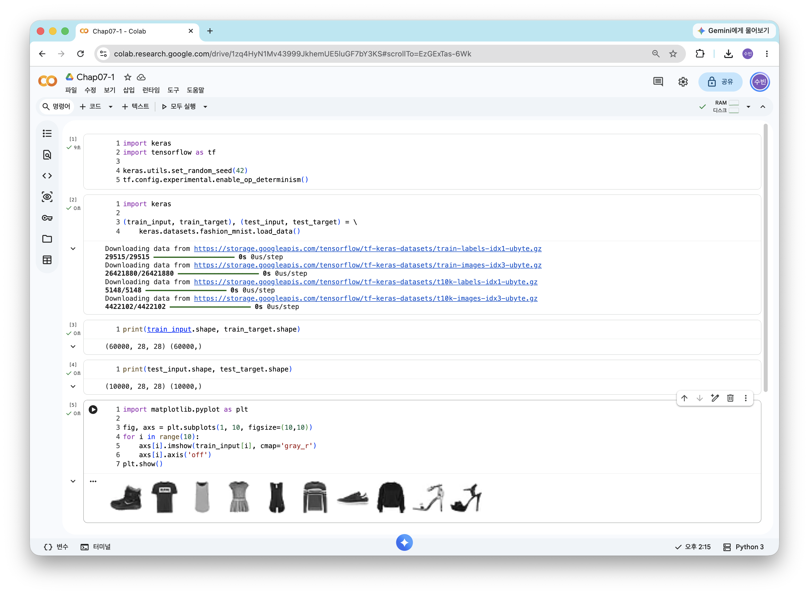
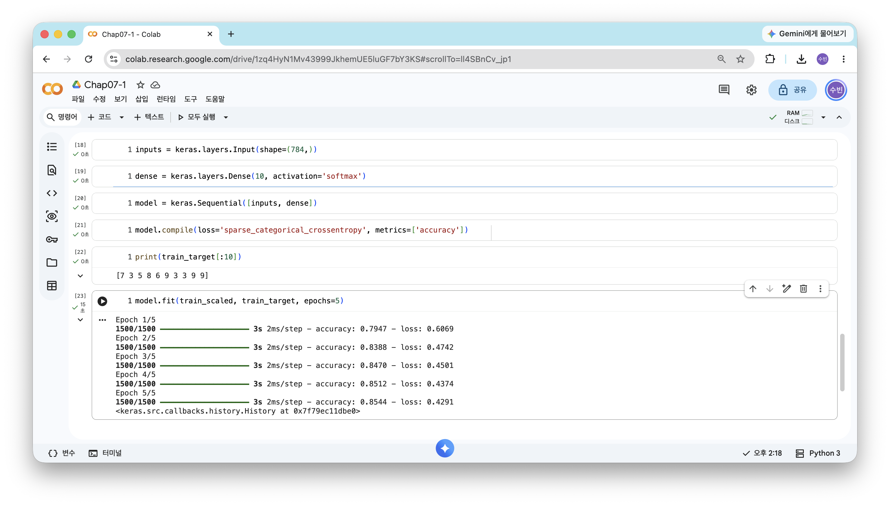
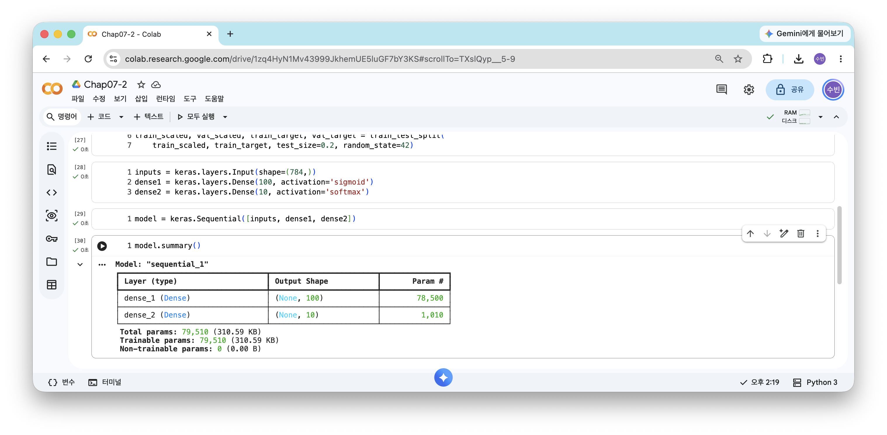
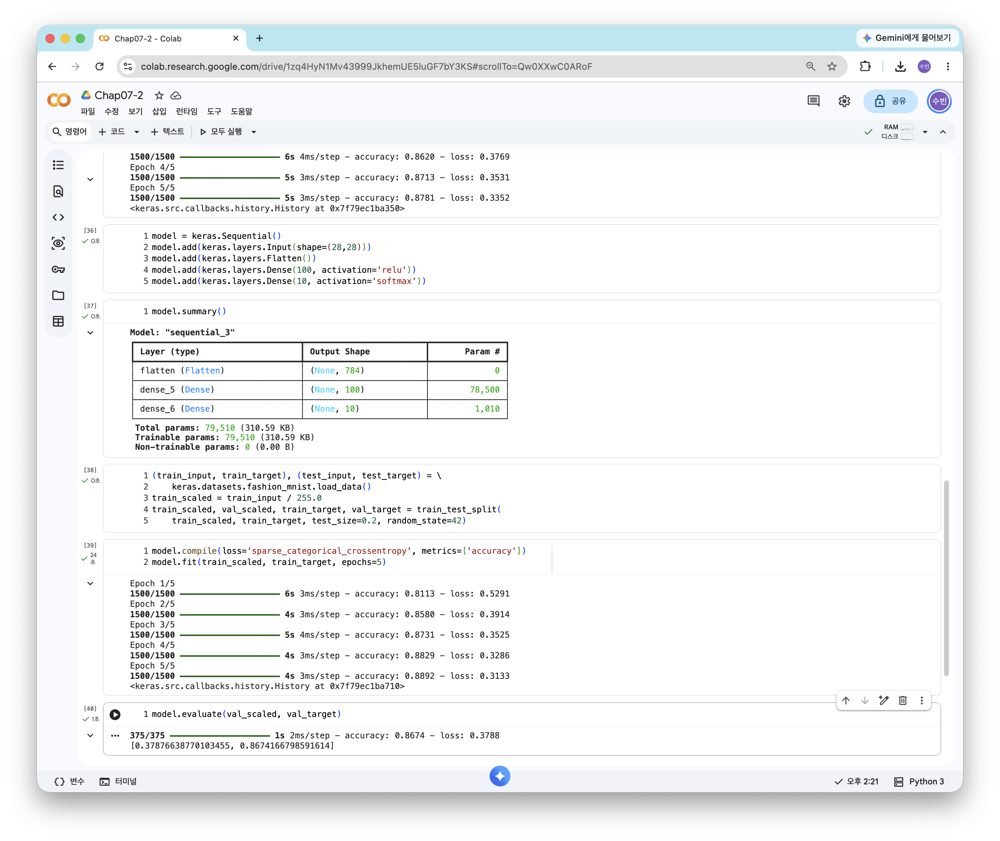
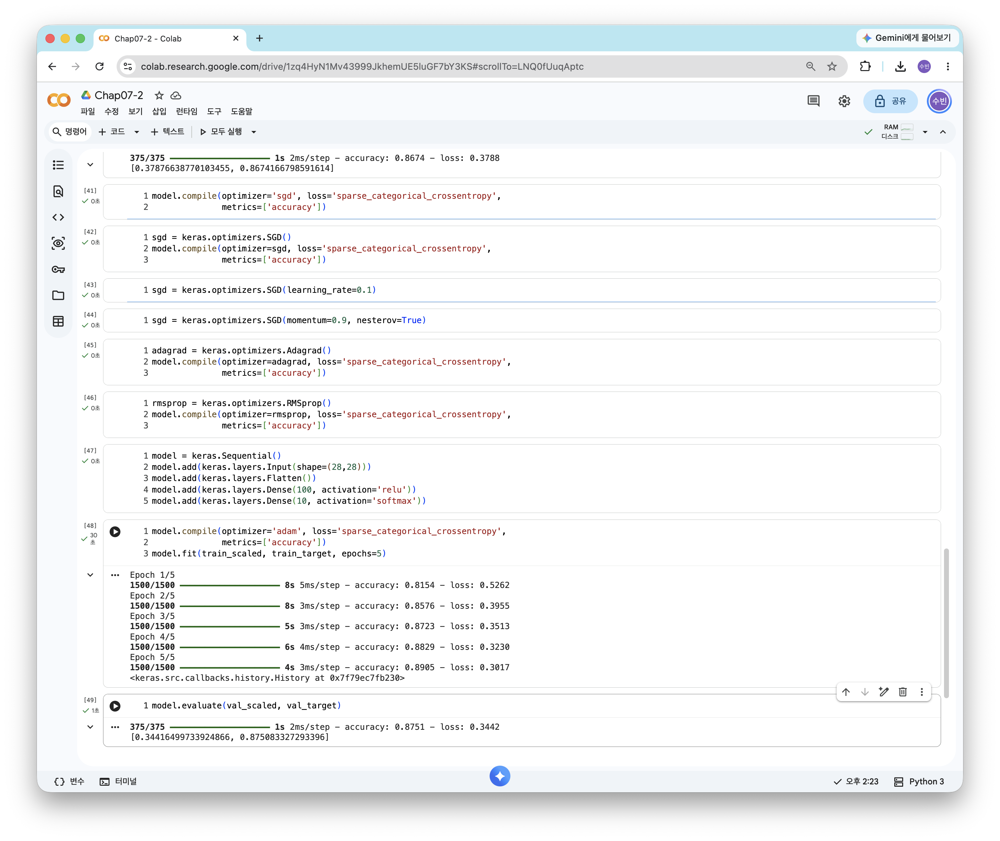

["혼자 공부하는 머신러닝+딥러닝(개정판)" 도서 바로가기](https://www.hanbit.co.kr/store/books/look.php?p_code=B7077594897)

예제 코드 (저자 제공): [07-1](https://colab.research.google.com/github/rickiepark/hg-mldl2/blob/main/07-1.ipynb), [07-2](https://colab.research.google.com/github/rickiepark/hg-mldl2/blob/main/07-2.ipynb), [07-3](https://colab.research.google.com/github/rickiepark/hg-mldl2/blob/main/07-3.ipynb)

# 7장. 딥러닝을 시작합니다


## 07-1. 인공 신경망

### 패션 MNIST

: 10종류의 패션 아이템을 28 × 28 크기의 흑백 이미지로 모은 데이터셋. 딥러닝의 "hello world" 같은 데이터다

```python
# 실행마다 동일한 결과를 얻기 위해 케라스에 랜덤 시드를 사용하고 텐서플로 연산을 결정적으로 만듭니다.
import keras
import tensorflow as tf

keras.utils.set_random_seed(42)
tf.config.experimental.enable_op_determinism()
```

- 신경망은 가중치를 랜덤하게 초기화하므로 실행할 때마다 결과가 조금씩 달라진다. 시드를 고정해 같은 결과를 얻는다

```python
import keras

(train_input, train_target), (test_input, test_target) = \
    keras.datasets.fashion_mnist.load_data()
```

- `load_data()`는 훈련 세트와 테스트 세트를 각각 입력과 타깃의 튜플로 나눠 반환한다
- 케라스가 유명한 데이터셋을 바로 내려받을 수 있는 `keras.datasets`를 제공한다

```python
print(train_input.shape, train_target.shape)
```

```
(60000, 28, 28) (60000,)
```

- 훈련 세트는 28 × 28 크기 이미지 60,000개, 타깃도 60,000개다

```python
print(test_input.shape, test_target.shape)
```

```
(10000, 28, 28) (10000,)
```

- 테스트 세트는 10,000개의 이미지로 되어 있다

```python
import matplotlib.pyplot as plt

fig, axs = plt.subplots(1, 10, figsize=(10,10))
for i in range(10):
    axs[i].imshow(train_input[i], cmap='gray_r')
    axs[i].axis('off')
plt.show()
```



- 처음 10개 샘플을 1행 10열 그래프로 그렸다. `gray_r`로 반전시켜 배경을 흰색으로 보이게 했다

```python
print(train_target[:10])
```

```
[9 0 0 3 0 2 7 2 5 5]
```

- 타깃은 0~9 사이의 정수 레이블이다. 위 이미지 순서대로 앵클 부츠, 티셔츠, 티셔츠, 드레스 …에 해당한다

```python
import numpy as np

print(np.unique(train_target, return_counts=True))
```

```
(array([0, 1, 2, 3, 4, 5, 6, 7, 8, 9], dtype=uint8), array([6000, 6000, 6000, 6000, 6000, 6000, 6000, 6000, 6000, 6000]))
```

- 0~9까지 10개의 레이블이 각각 **6000개씩** 골고루 들어 있다
    - 0 티셔츠, 1 바지, 2 스웨터, 3 드레스, 4 코트, 5 샌들, 6 셔츠, 7 스니커즈, 8 가방, 9 앵클 부츠

### 로지스틱 회귀로 패션 아이템 분류하기

```python
train_scaled = train_input / 255.0
train_scaled = train_scaled.reshape(-1, 28*28)
```

- 픽셀값 0~255를 **255로 나눠 0~1 사이로** 만든다 (정규화)
- 사이킷런 모델에 넣기 위해 1차원 배열(784개 특성)로 편다

```python
print(train_scaled.shape)
```

```
(60000, 784)
```

- 784개(28 × 28) 픽셀로 이루어진 60,000개의 샘플이 준비되었다

```python
from sklearn.model_selection import cross_validate
from sklearn.linear_model import SGDClassifier

sc = SGDClassifier(loss='log_loss', max_iter=5, random_state=42)
scores = cross_validate(sc, train_scaled, train_target, n_jobs=-1)
print(np.mean(scores['test_score']))
```

```
0.8194166666666666
```

- `loss='log_loss'`로 로지스틱 손실 함수를 지정하고, `max_iter=5`로 반복을 5번만 했다
- 데이터가 크므로 `cross_validate()`에 `n_jobs=-1`을 줘 모든 CPU 코어를 사용한다
- 확률적 경사 하강법으로 로지스틱 회귀를 훈련하면 약 **0.82** 의 정확도가 나온다
- 로지스틱 회귀는 클래스마다 784개의 픽셀에 가중치를 곱한 z 값을 계산하고, 소프트맥스로 확률을 구한다

### 인공 신경망

: 생물학적 뉴런에서 영감을 받아 만든 머신러닝 알고리즘. **딥러닝**은 곧 인공 신경망을 말한다

- **뉴런(unit)**: z 값을 계산하는 단위. 로지스틱 회귀의 계산과 같다
- **입력층(input layer)**: 입력 그 자체인 픽셀값 784개
- **출력층(output layer)**: 최종 값을 만드는 층. 여기서는 클래스 10개에 대응하는 뉴런 10개
- **활성화 함수(activation function)**: 뉴런의 출력에 적용하는 함수. 출력층에서는 소프트맥스(다중 분류), 시그모이드(이진 분류)를 쓴다
- 딥러닝 라이브러리: **텐서플로**와 그 고수준 API인 **케라스**, 그리고 **파이토치**

```python
import tensorflow as tf
```

```python
import keras
```

```python
keras.config.backend()
```

```
'tensorflow'
```

- `keras.config.backend()`: 현재 케라스가 사용하는 백엔드를 확인한다. 코랩 기본값은 텐서플로다

```python
import os
os.environ["KERAS_BACKEND"] = "torch"   # 또는 "jax"
```

- 백엔드를 바꾸려면 케라스를 임포트하기 **전에** `KERAS_BACKEND` 환경 변수를 지정해야 한다
- 케라스는 텐서플로뿐 아니라 **파이토치, JAX**를 백엔드로 사용할 수 있다

### 인공 신경망으로 모델 만들기

```python
from sklearn.model_selection import train_test_split

train_scaled, val_scaled, train_target, val_target = train_test_split(
    train_scaled, train_target, test_size=0.2, random_state=42)
```

```python
print(train_scaled.shape, train_target.shape)
```

```
(48000, 784) (48000,)
```

```python
print(val_scaled.shape, val_target.shape)
```

```
(12000, 784) (12000,)
```

- 60,000개 중 20%인 12,000개를 검증 세트로 떼어 냈다

- 딥러닝은 데이터가 크고 훈련이 오래 걸리므로 **교차 검증 대신 검증 세트**를 한 번 떼어 사용한다

```python
inputs = keras.layers.Input(shape=(784,))
```

- `Input`: 입력층. `shape`에 샘플 하나의 크기(784개 특성)를 튜플로 지정한다

```python
dense = keras.layers.Dense(10, activation='softmax')
```

- **밀집층(dense layer)**: 앞 층의 모든 뉴런과 **완전히 연결**된 층. **완전 연결 층**이라고도 한다
- `Dense(10, ...)`: 뉴런 개수 10개, 활성화 함수는 소프트맥스
    - 784개 픽셀과 뉴런 10개가 모두 연결되므로 가중치는 784 × 10 = 7,840개다

```python
model = keras.Sequential([inputs, dense])
```

- `Sequential`: 층을 순서대로 쌓아 모델을 만드는 클래스

### 인공 신경망으로 패션 아이템 분류하기

```python
model.compile(loss='sparse_categorical_crossentropy', metrics=['accuracy'])
```

- `compile()`: 훈련 전에 **손실 함수**와 **측정 지표**를 지정한다
- **크로스엔트로피 손실 함수**
    - `categorical_crossentropy`: 타깃이 원-핫 인코딩되어 있을 때
    - `sparse_categorical_crossentropy`: 타깃이 정수 그대로일 때
- **원-핫 인코딩(one-hot encoding)**: 정답 클래스만 1, 나머지는 0인 배열로 바꾸는 것

```python
print(train_target[:10])
```

```
[7 3 5 8 6 9 3 3 9 9]
```

- 타깃이 원-핫 인코딩 없이 정수이므로 `sparse_categorical_crossentropy`를 사용한다

```python
model.fit(train_scaled, train_target, epochs=5)
```

- `epochs`: 반복할 에포크 횟수. 케라스는 에포크마다 손실과 정확도를 출력한다
- 사이킷런처럼 `fit()`에 입력과 타깃을 전달한다



```python
model.evaluate(val_scaled, val_target)
```

```
[0.4444445073604584, 0.8458333611488342]
```

- `evaluate()`: 검증 세트로 손실과 정확도를 확인한다. 약 **0.85**
    - 반환값은 `[손실, 정확도]` 순서의 리스트다

### 인공 신경망 모델로 성능 향상

이번 절의 문제 해결 과정을 정리하면 다음과 같다.

1. **데이터 준비**: 패션 MNIST를 255로 나눠 정규화하고 1차원으로 폄
2. **기존 방법**: 확률적 경사 하강법 + 로지스틱 회귀 → 교차 검증 정확도 약 0.82
3. **인공 신경망**: 밀집층 하나(뉴런 10개, 소프트맥스)로 된 모델을 케라스로 구성
4. **훈련과 평가**: `compile()` → `fit()` → `evaluate()` 순서로 진행 → 검증 정확도 약 0.85
5. 같은 계산을 하는데도 신경망 쪽 성능이 더 좋다. 케라스는 기본적으로 **미니배치 경사 하강법(배치 크기 32)과 RMSprop 옵티마이저**를 사용하는 등 훈련 방식이 다르기 때문

<hr>

## 07-2. 심층 신경망

### 2개의 층

```python
# 실행마다 동일한 결과를 얻기 위해 케라스에 랜덤 시드를 사용하고 텐서플로 연산을 결정적으로 만듭니다.
import keras
import tensorflow as tf

keras.utils.set_random_seed(42)
tf.config.experimental.enable_op_determinism()
```

```python
import keras

(train_input, train_target), (test_input, test_target) = \
    keras.datasets.fashion_mnist.load_data()
```

```python
from sklearn.model_selection import train_test_split

train_scaled = train_input / 255.0
train_scaled = train_scaled.reshape(-1, 28*28)

train_scaled, val_scaled, train_target, val_target = train_test_split(
    train_scaled, train_target, test_size=0.2, random_state=42)
```

- 1절과 똑같이 데이터를 정규화하고 1차원으로 편 뒤 검증 세트를 나눈다

```python
inputs = keras.layers.Input(shape=(784,))
dense1 = keras.layers.Dense(100, activation='sigmoid')
dense2 = keras.layers.Dense(10, activation='softmax')
```

- **은닉층(hidden layer)**: 입력층과 출력층 사이에 있는 층
- `dense1`은 뉴런 100개에 시그모이드를 쓰는 은닉층, `dense2`는 뉴런 10개에 소프트맥스를 쓰는 출력층이다
- 은닉층의 뉴런 개수는 정해진 규칙이 없다. 다만 **출력층의 뉴런보다는 많아야** 한다
- 은닉층에는 활성화 함수가 꼭 필요하다. 없으면 두 층을 이어도 하나의 선형 계산으로 합쳐져 **층을 쌓는 의미가 사라진다**

### 심층 신경망 만들기

```python
model = keras.Sequential([inputs, dense1, dense2])
```

- **심층 신경망(Deep Neural Network, DNN)**: 2개 이상의 층을 쌓은 인공 신경망
- 리스트에 입력층, 은닉층, 출력층을 **순서대로** 넣어야 한다

```python
model.summary()
```

```
 Total params: 79,510 (310.59 KB)
 Trainable params: 79,510 (310.59 KB)
 Non-trainable params: 0 (0.00 B)
```

- `summary()`: 층 구성, 출력 크기, 모델 파라미터 개수를 보여 준다
- 은닉층: 784 × 100 + 100 = 78,500개, 출력층: 100 × 10 + 10 = 1,010개 → 합계 79,510개
- 출력 크기의 첫 번째 차원이 `None`인 이유: **미니배치 크기**가 정해져 있지 않기 때문 (기본 배치 크기 32)



### 층을 추가하는 다른 방법

```python
model = keras.Sequential([
    keras.layers.Input(shape=(784,)),
    keras.layers.Dense(100, activation='sigmoid', name='은닉층'),
    keras.layers.Dense(10, activation='softmax', name='출력층')
], name='패션 MNIST 모델')
```

```python
model.summary()
```

- `Sequential`에 층 객체를 **바로 전달**할 수 있고, 모델과 층에 `name`을 붙일 수도 있다

```python
model = keras.Sequential()
model.add(keras.layers.Input(shape=(784,)))
model.add(keras.layers.Dense(100, activation='sigmoid'))
model.add(keras.layers.Dense(10, activation='softmax'))
```

```python
model.summary()
```

- 이 방법은 층 객체를 따로 변수에 저장하지 않으므로 코드가 간결하다
- `add()`: 층을 하나씩 추가하는 방법. 조건에 따라 층을 추가할 수 있어 유연하다

```python
model.compile(loss='sparse_categorical_crossentropy', metrics=['accuracy'])
model.fit(train_scaled, train_target, epochs=5)
```

- 은닉층을 추가했더니 1절보다 훈련 정확도가 올라갔다
- 모델 구성 방식만 달라졌을 뿐 `compile()`과 `fit()` 사용법은 같다

### 렐루 함수

: 입력이 양수면 그대로 통과시키고, 음수면 0으로 만드는 활성화 함수 `max(0, z)`

- 시그모이드 함수는 양 끝으로 갈수록 그래프가 **완만해져** 출력 변화가 작아진다 → 층이 깊어질수록 학습이 어렵다
- 렐루는 계산이 간단하고, 특히 **이미지 처리**에서 좋은 성능을 낸다

```python
model = keras.Sequential()
model.add(keras.layers.Input(shape=(28,28)))
model.add(keras.layers.Flatten())
model.add(keras.layers.Dense(100, activation='relu'))
model.add(keras.layers.Dense(10, activation='softmax'))
```

- **Flatten 층**: 입력의 차원을 **일렬로 펴 주는** 층. 학습하는 파라미터는 없다
    - 직접 `reshape()` 하지 않아도 되고, 입력 크기를 코드에서 바로 확인할 수 있다

```python
model.summary()
```

- `summary()`를 보면 Flatten 층의 출력이 784이고 파라미터는 0개다

```python
(train_input, train_target), (test_input, test_target) = \
    keras.datasets.fashion_mnist.load_data()
train_scaled = train_input / 255.0
train_scaled, val_scaled, train_target, val_target = train_test_split(
    train_scaled, train_target, test_size=0.2, random_state=42)
```

- 이번에는 Flatten 층이 펴 주므로 `reshape()`를 하지 않고 2차원 이미지 그대로 둔다

```python
model.compile(loss='sparse_categorical_crossentropy', metrics=['accuracy'])
model.fit(train_scaled, train_target, epochs=5)
```

```python
model.evaluate(val_scaled, val_target)
```

```
[0.37969112396240234, 0.8652499914169312]
```

- 시그모이드를 썼을 때보다 검증 정확도가 올랐다



### 옵티마이저

: 신경망의 가중치와 절편을 학습하기 위한 **경사 하강법 알고리즘**. 케라스에서 골라 쓸 수 있는 하이퍼파라미터다

```python
model.compile(optimizer='sgd', loss='sparse_categorical_crossentropy',
              metrics=['accuracy'])
```

- `compile()`의 기본 옵티마이저는 RMSprop이다. `optimizer='sgd'`로 확률적 경사 하강법을 지정할 수 있다

```python
sgd = keras.optimizers.SGD()
model.compile(optimizer=sgd, loss='sparse_categorical_crossentropy',
              metrics=['accuracy'])
```

- `'sgd'` 문자열은 `keras.optimizers.SGD` 객체를 기본 설정으로 만든 것과 같다

```python
sgd = keras.optimizers.SGD(learning_rate=0.1)
```

- 객체로 만들면 `learning_rate` 같은 매개변수를 직접 바꿀 수 있다 (기본값 0.01)

```python
sgd = keras.optimizers.SGD(momentum=0.9, nesterov=True)
```

- **모멘텀 최적화**: 이전 그레이디언트를 가속도처럼 사용한다 (보통 `momentum=0.9`)
- **네스테로프 모멘텀**: 모멘텀 최적화를 두 번 반복해 구현한다

```python
adagrad = keras.optimizers.Adagrad()
model.compile(optimizer=adagrad, loss='sparse_categorical_crossentropy',
              metrics=['accuracy'])
```

```python
rmsprop = keras.optimizers.RMSprop()
model.compile(optimizer=rmsprop, loss='sparse_categorical_crossentropy',
              metrics=['accuracy'])
```

- **적응적 학습률(adaptive learning rate)**: 모델이 최적점에 가까워지면 학습률을 자동으로 낮추는 방식
    - `Adagrad`, `RMSprop`이 대표적이다

```python
model = keras.Sequential()
model.add(keras.layers.Input(shape=(28,28)))
model.add(keras.layers.Flatten())
model.add(keras.layers.Dense(100, activation='relu'))
model.add(keras.layers.Dense(10, activation='softmax'))
```

```python
model.compile(optimizer='adam', loss='sparse_categorical_crossentropy',
              metrics=['accuracy'])
model.fit(train_scaled, train_target, epochs=5)
```

```python
model.evaluate(val_scaled, val_target)
```

```
[0.3521900177001953, 0.8723333477973938]
```

- `optimizer='adam'`으로 지정해 다시 훈련했다. 기본 RMSprop보다 검증 정확도가 조금 더 높다

- **Adam**: 모멘텀 최적화와 RMSprop의 장점을 합친 옵티마이저. 기본적으로 많이 쓰인다



### 케라스 API를 활용한 심층 신경망

이번 절의 문제 해결 과정을 정리하면 다음과 같다.

1. **은닉층 추가**: 입력층과 출력층 사이에 시그모이드 활성화 함수를 쓰는 밀집층을 추가 → 심층 신경망
2. **층 추가 방법**: `Sequential`에 리스트로 전달 / `add()`로 하나씩 추가
3. **Flatten 층**: `reshape()` 대신 층으로 입력을 펴서 코드가 더 명확해짐
4. **활성화 함수 교체**: 시그모이드 → **렐루** → 검증 정확도 0.865
5. **옵티마이저 교체**: 기본 RMSprop → **Adam** → 검증 정확도 0.872

<hr>

## 07-3. 신경망 모델 훈련

### 손실 곡선

```python
# 실행마다 동일한 결과를 얻기 위해 케라스에 랜덤 시드를 사용하고 텐서플로 연산을 결정적으로 만듭니다.
import keras
import tensorflow as tf

keras.utils.set_random_seed(42)
tf.random.set_seed(42)
tf.config.experimental.enable_op_determinism()
```

```python
import keras
from sklearn.model_selection import train_test_split

(train_input, train_target), (test_input, test_target) = \
    keras.datasets.fashion_mnist.load_data()

train_scaled = train_input / 255.0

train_scaled, val_scaled, train_target, val_target = train_test_split(
    train_scaled, train_target, test_size=0.2, random_state=42)
```

```python
def model_fn(a_layer=None):
    model = keras.Sequential()
    model.add(keras.layers.Input(shape=(28,28)))
    model.add(keras.layers.Flatten())
    model.add(keras.layers.Dense(100, activation='relu'))
    if a_layer:
        model.add(a_layer)
    model.add(keras.layers.Dense(10, activation='softmax'))
    return model
```

- `a_layer`에 층을 전달하면 은닉층 뒤에 그 층을 추가하고, 전달하지 않으면 2절과 같은 모델이 만들어진다
- 층을 하나 추가할 수 있도록 매개변수를 둔 **모델 생성 함수**를 만들어 두면 실험하기 편하다

```python
model = model_fn()
model.summary()
```

```python
model.compile(loss='sparse_categorical_crossentropy', metrics=['accuracy'])
history = model.fit(train_scaled, train_target, epochs=5, verbose=0)
```

- `fit()`은 **History 객체**를 반환한다. 에포크마다의 손실과 정확도가 들어 있다
- `verbose=0`: 훈련 과정을 출력하지 않는다

```python
print(history.history.keys())
```

```
dict_keys(['accuracy', 'loss'])
```

- `compile()`에서 `metrics=['accuracy']`를 지정했기 때문에 손실과 함께 정확도가 기록된다

```python
import matplotlib.pyplot as plt

plt.plot(history.history['loss'])
plt.xlabel('epoch')
plt.ylabel('loss')
plt.show()
```

```python
plt.plot(history.history['accuracy'])
plt.xlabel('epoch')
plt.ylabel('accuracy')
plt.show()
```

- 에포크마다 손실은 줄고 정확도는 올라간다

<!-- 캡처: 에포크에 따른 손실 곡선

-->

```python
model = model_fn()
model.compile(loss='sparse_categorical_crossentropy', metrics=['accuracy'])
history = model.fit(train_scaled, train_target, epochs=20, verbose=0)
```

```python
plt.plot(history.history['loss'])
plt.xlabel('epoch')
plt.ylabel('loss')
plt.show()
```

- 에포크를 20으로 늘리면 훈련 손실은 계속 줄어든다. 하지만 이것만으로는 과대적합인지 알 수 없다

### 검증 손실

```python
model = model_fn()
model.compile(loss='sparse_categorical_crossentropy', metrics=['accuracy'])
history = model.fit(train_scaled, train_target, epochs=20, verbose=0,
                    validation_data=(val_scaled, val_target))
```

- `validation_data`: 에포크마다 검증 세트의 손실과 정확도를 함께 계산한다

```python
print(history.history.keys())
```

```
dict_keys(['accuracy', 'loss', 'val_accuracy', 'val_loss'])
```

- 검증 세트에 대한 값은 `val_` 접두사가 붙은 키로 저장된다

```python
plt.plot(history.history['loss'], label='train')
plt.plot(history.history['val_loss'], label='val')
plt.xlabel('epoch')
plt.ylabel('loss')
plt.legend()
plt.show()
```

- 훈련 손실은 계속 줄지만 검증 손실은 어느 지점부터 **다시 올라간다** → 그 지점부터 과대적합

<!-- 캡처: 훈련 손실과 검증 손실 비교 그래프

-->

```python
model = model_fn()
model.compile(optimizer='adam', loss='sparse_categorical_crossentropy',
              metrics=['accuracy'])
history = model.fit(train_scaled, train_target, epochs=20, verbose=0,
                    validation_data=(val_scaled, val_target))
```

```python
plt.plot(history.history['loss'], label='train')
plt.plot(history.history['val_loss'], label='val')
plt.xlabel('epoch')
plt.ylabel('loss')
plt.legend()
plt.show()
```

- 과대적합을 줄이기 위해 옵티마이저만 Adam으로 바꿔 같은 그래프를 그렸다
- 옵티마이저를 Adam으로 바꾸니 과대적합이 줄고 검증 손실 곡선이 더 안정적이다

### 드롭아웃

: 훈련할 때 일부 뉴런의 출력을 **랜덤하게 0으로 만들어** 과대적합을 막는 기법

- 특정 뉴런에 지나치게 의존하지 않게 되고, 여러 신경망을 앙상블한 것 같은 효과가 난다
- 훈련이 끝난 뒤 **평가와 예측에서는 드롭아웃을 적용하지 않는다** (케라스가 알아서 처리한다)

```python
model = model_fn(keras.layers.Dropout(0.3))
model.summary()
```

- `Dropout(0.3)`: 30%의 뉴런을 끈다. 학습하는 파라미터는 없다
    - 앞에서 만든 `model_fn()`에 드롭아웃 층을 전달해 은닉층 뒤에 추가했다

```python
model.compile(optimizer='adam', loss='sparse_categorical_crossentropy',
              metrics=['accuracy'])
history = model.fit(train_scaled, train_target, epochs=20, verbose=0,
                    validation_data=(val_scaled, val_target))
```

```python
plt.plot(history.history['loss'], label='train')
plt.plot(history.history['val_loss'], label='val')
plt.xlabel('epoch')
plt.ylabel('loss')
plt.legend()
plt.show()
```

- 드롭아웃을 적용한 모델을 Adam으로 20 에포크 훈련하고 손실 곡선을 그렸다
- 검증 손실이 다시 올라가는 시점이 늦춰지고, 두 곡선의 간격도 줄었다

<!-- 캡처: 드롭아웃을 적용한 손실 곡선

-->

### 모델 저장과 복원

```python
model = model_fn(keras.layers.Dropout(0.3))
model.compile(optimizer='adam', loss='sparse_categorical_crossentropy',
              metrics=['accuracy'])
history = model.fit(train_scaled, train_target, epochs=11, verbose=0,
                    validation_data=(val_scaled, val_target))
```

- 앞 그래프에서 과대적합이 시작되기 전인 **11 에포크**만 다시 훈련했다

```python
model.save('model-whole.keras')
```

```python
model.save_weights('model.weights.h5')
```

```python
!ls -al model*
```

- `save()`: 모델 구조와 파라미터를 **모두** 저장한다
- `save_weights()`: 학습한 **파라미터만** 저장한다
- `!ls -al model*`로 두 파일이 만들어진 것을 확인한다

```python
model = model_fn(keras.layers.Dropout(0.3))
model.load_weights('model.weights.h5')
```

```python
import numpy as np

val_labels = np.argmax(model.predict(val_scaled), axis=-1)
print(np.mean(val_labels == val_target))
```

```
0.8829166666666667
```

- `load_weights()`로 파라미터만 불러올 때는 **같은 구조의 모델**을 먼저 만들어야 한다
- `predict()`는 샘플마다 10개 클래스의 확률을 반환한다. `axis=-1`은 마지막 차원(클래스 방향)을 따라 최댓값을 찾는다
- 예측 레이블과 타깃을 비교한 불리언 배열의 평균이 곧 정확도다
- `np.argmax()`: 소프트맥스 확률에서 가장 큰 값의 **인덱스(클래스)** 를 고른다

```python
model = keras.models.load_model('model-whole.keras')
model.evaluate(val_scaled, val_target)
```

```
[0.32348448038101196, 0.8829166889190674]
```

- `load_model()`: 모델 구조와 파라미터를 한 번에 복원한다. 컴파일 설정도 함께 복원되어 `evaluate()`를 바로 쓸 수 있다

### 콜백

: 훈련 과정 중간에 어떤 작업을 수행할 수 있게 해 주는 객체. `fit()`의 `callbacks` 매개변수에 전달한다

```python
model = model_fn(keras.layers.Dropout(0.3))
model.compile(optimizer='adam', loss='sparse_categorical_crossentropy',
              metrics=['accuracy'])
checkpoint_cb = keras.callbacks.ModelCheckpoint('best-model.keras',
                                                save_best_only=True)
model.fit(train_scaled, train_target, epochs=20, verbose=0,
          validation_data=(val_scaled, val_target),
          callbacks=[checkpoint_cb])
```

- `ModelCheckpoint`: 에포크마다 모델을 저장한다. `save_best_only=True`면 **검증 점수가 가장 좋은 모델만** 남긴다

```python
model = keras.models.load_model('best-model.keras')
model.evaluate(val_scaled, val_target)
```

```
[0.32222074270248413, 0.8847500085830688]
```

- `best-model.keras`에는 검증 손실이 가장 낮았던 에포크의 모델이 저장되어 있다
- 여전히 20 에포크를 모두 훈련하므로, 과대적합 이후의 훈련은 낭비다

```python
model = model_fn(keras.layers.Dropout(0.3))
model.compile(optimizer='adam', loss='sparse_categorical_crossentropy',
              metrics=['accuracy'])
checkpoint_cb = keras.callbacks.ModelCheckpoint('best-model.keras',
                                                save_best_only=True)
early_stopping_cb = keras.callbacks.EarlyStopping(patience=2,
                                                  restore_best_weights=True)
history = model.fit(train_scaled, train_target, epochs=20, verbose=0,
                    validation_data=(val_scaled, val_target),
                    callbacks=[checkpoint_cb, early_stopping_cb])
```

- `EarlyStopping`: 검증 점수가 나아지지 않으면 훈련을 **조기 종료**한다
    - `patience=2`: 2번 연속 나아지지 않으면 중단
    - `restore_best_weights=True`: 가장 좋았던 파라미터로 되돌린다

```python
print(early_stopping_cb.stopped_epoch)
```

```
12
```

- `stopped_epoch`는 0부터 세므로 13번째 에포크에서 훈련이 멈췄다
    - `patience=2`이므로 최상의 모델은 그보다 2 에포크 전인 11번째 에포크다

```python
plt.plot(history.history['loss'], label='train')
plt.plot(history.history['val_loss'], label='val')
plt.xlabel('epoch')
plt.ylabel('loss')
plt.legend()
plt.show()
```

```python
model.evaluate(val_scaled, val_target)
```

```
[0.3233264982700348, 0.8853333592414856]
```

- `restore_best_weights=True` 덕분에 모델은 가장 좋았던 파라미터 상태로 평가된다

<!-- 캡처: 조기 종료가 적용된 손실 곡선

-->

### 최상의 신경망 모델 얻기

이번 절의 문제 해결 과정을 정리하면 다음과 같다.

1. **손실 곡선 확인**: `History` 객체로 에포크별 손실을 그려 훈련 상태를 관찰
2. **검증 손실 추가**: `validation_data`로 과대적합이 시작되는 지점을 파악
3. **옵티마이저 조정**: Adam으로 바꿔 과대적합 완화
4. **드롭아웃 적용**: 30% 드롭아웃으로 훈련/검증 손실 간격을 더 줄임
5. **콜백 사용**: `ModelCheckpoint`로 최상의 모델을 저장하고, `EarlyStopping`으로 적절한 시점에 훈련 종료 → 검증 정확도 약 0.885

<hr>

## 📌 정리

- 패션 MNIST로 **인공 신경망**을 만들고, 케라스의 `compile()` → `fit()` → `evaluate()` 흐름을 익혔다
- 은닉층을 추가해 **심층 신경망**을 만들고, 활성화 함수를 시그모이드에서 **렐루**로 바꿔 성능을 높였다
- **옵티마이저**(SGD, 모멘텀, RMSprop, Adam)를 바꾸는 것만으로 학습 방식과 성능이 달라진다
- 손실 곡선과 검증 손실로 과대적합 시점을 파악하고, **드롭아웃과 콜백**(체크포인트, 조기 종료)으로 최상의 모델을 얻는다

**핵심 용어**: 인공 신경망 / 밀집층 / 은닉층 / 심층 신경망 / 렐루 함수 / 옵티마이저 / Adam / 손실 곡선 / 검증 손실 / 드롭아웃 / 콜백 / 조기 종료

## 💬 스터디 토의

### 토의 주제 1. 드롭아웃은 어떻게 신경망의 성능을 향상시키는 것일까? (07-3)

**학습에 사용할 수 있는 뉴런의 수를 줄이는 것이 오히려 과대적합을 방지하고 일반화 성능을 높이는 이유는 무엇일까? 드롭아웃 비율을 지나치게 높이면 어떤 문제가 발생할까?**
- **과소적합(underfitting)**
  - 남는 뉴런이 너무 적어 모델의 표현력이 부족해진다
  - 훈련 데이터의 패턴조차 제대로 못 배워 훈련·검증 성능이 둘 다 낮아진다
- **특수 케이스에 치중**
  - 소수의 뉴런만으로 맞혀야 하니, 일부 샘플에만 맞는 특징에 의존하게 된다

### 토의 주제 2. 검증 손실이 증가하기 시작하면 반드시 학습을 중단해야 할까? (07-3)

**일반적으로 훈련 손실은 계속 감소하지만 검증 손실이 증가하기 시작하면 과대적합이 발생했다고 판단한다. 검증 손실이 일시적으로 증가한 경우에도 학습을 중단하는 것이 적절할까?**
- **어려운 문제를 만나면 손실이 일시적으로 증가할 수 있다**
  - 아직 제대로 학습하지 못한 어려운 샘플을 만나면 검증 손실이 잠깐 오를 수 있다
  - 이것은 과대적합이 아니라 학습 과정의 일부다. 계속 학습하면 다시 낮아질 수 있다
- **한 지점이 아니라 변화 추이를 봐야 한다**
  - 검증 손실이 한 번 올랐는지가 아니라, 오르는 추세가 계속 이어지는지 봐야 한다
- **`patience`로 기다린다**
- **잠깐 올랐다가 더 낮게 내려가는 경우도 흔하다**
  - 바로 멈추면 더 좋아질 수 있었던 모델을 일찍 버리게 되므로, 일시적인 증가에는 학습을 계속하는 것이 적절하다
