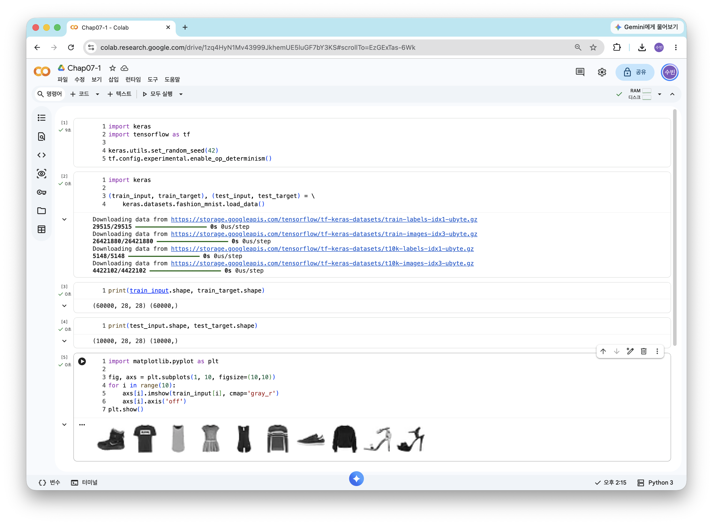
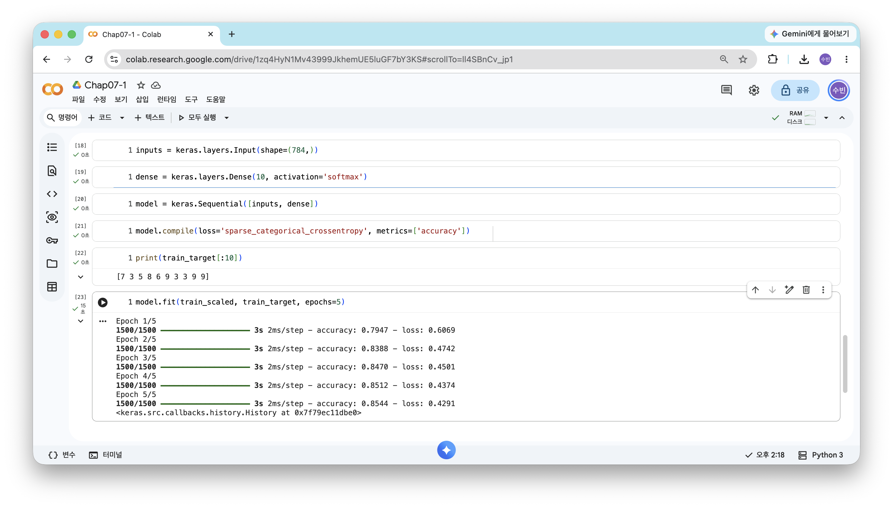

["혼자 공부하는 머신러닝+딥러닝(개정판)" 도서 바로가기](https://www.hanbit.co.kr/store/books/look.php?p_code=B7077594897)

예제 코드 (저자 제공): [07-1](https://colab.research.google.com/github/rickiepark/hg-mldl2/blob/main/07-1.ipynb)

# 7장. 딥러닝을 시작합니다


## 07-1. 인공 신경망

### 패션 MNIST

: 10종류의 패션 아이템을 28 × 28 크기의 흑백 이미지로 모은 데이터셋. 딥러닝의 "hello world" 같은 데이터다

```python
# 실행마다 동일한 결과를 얻기 위해 케라스에 랜덤 시드를 사용하고 텐서플로 연산을 결정적으로 만듭니다.
import keras
import tensorflow as tf

keras.utils.set_random_seed(42)
tf.config.experimental.enable_op_determinism()
```

- 신경망은 가중치를 랜덤하게 초기화하므로 실행할 때마다 결과가 조금씩 달라진다. 시드를 고정해 같은 결과를 얻는다

```python
import keras

(train_input, train_target), (test_input, test_target) = \
    keras.datasets.fashion_mnist.load_data()
```

- `load_data()`는 훈련 세트와 테스트 세트를 각각 입력과 타깃의 튜플로 나눠 반환한다
- 케라스가 유명한 데이터셋을 바로 내려받을 수 있는 `keras.datasets`를 제공한다

```python
print(train_input.shape, train_target.shape)
```

```
(60000, 28, 28) (60000,)
```

- 훈련 세트는 28 × 28 크기 이미지 60,000개, 타깃도 60,000개다

```python
print(test_input.shape, test_target.shape)
```

```
(10000, 28, 28) (10000,)
```

- 테스트 세트는 10,000개의 이미지로 되어 있다

```python
import matplotlib.pyplot as plt

fig, axs = plt.subplots(1, 10, figsize=(10,10))
for i in range(10):
    axs[i].imshow(train_input[i], cmap='gray_r')
    axs[i].axis('off')
plt.show()
```

<!-- 캡처: 패션 MNIST 샘플 10개

-->

- 처음 10개 샘플을 1행 10열 그래프로 그렸다. `gray_r`로 반전시켜 배경을 흰색으로 보이게 했다

```python
print(train_target[:10])
```

```
[9 0 0 3 0 2 7 2 5 5]
```

- 타깃은 0~9 사이의 정수 레이블이다. 위 이미지 순서대로 앵클 부츠, 티셔츠, 티셔츠, 드레스 …에 해당한다

```python
import numpy as np

print(np.unique(train_target, return_counts=True))
```

```
(array([0, 1, 2, 3, 4, 5, 6, 7, 8, 9], dtype=uint8), array([6000, 6000, 6000, 6000, 6000, 6000, 6000, 6000, 6000, 6000]))
```

- 0~9까지 10개의 레이블이 각각 **6000개씩** 골고루 들어 있다
    - 0 티셔츠, 1 바지, 2 스웨터, 3 드레스, 4 코트, 5 샌달, 6 셔츠, 7 스니커즈, 8 가방, 9 앵클 부츠

### 로지스틱 회귀로 패션 아이템 분류하기

```python
train_scaled = train_input / 255.0
train_scaled = train_scaled.reshape(-1, 28*28)
```

- 픽셀값 0~255를 **255로 나눠 0~1 사이로** 만든다 (정규화)
- 사이킷런 모델에 넣기 위해 1차원 배열(784개 특성)로 편다

```python
print(train_scaled.shape)
```

```
(60000, 784)
```

- 784개(28 × 28) 픽셀로 이루어진 60,000개의 샘플이 준비되었다

```python
from sklearn.model_selection import cross_validate
from sklearn.linear_model import SGDClassifier

sc = SGDClassifier(loss='log_loss', max_iter=5, random_state=42)
scores = cross_validate(sc, train_scaled, train_target, n_jobs=-1)
print(np.mean(scores['test_score']))
```

```
0.8194166666666666
```

- `loss='log_loss'`로 로지스틱 손실 함수를 지정하고, `max_iter=5`로 반복을 5번만 했다
- 데이터가 크므로 `cross_validate()`에 `n_jobs=-1`을 줘 모든 CPU 코어를 사용한다
- 확률적 경사 하강법으로 로지스틱 회귀를 훈련하면 약 **0.82** 의 정확도가 나온다
- 로지스틱 회귀는 클래스마다 784개의 픽셀에 가중치를 곱한 z 값을 계산하고, 소프트맥스로 확률을 구한다

### 인공 신경망

: 생물학적 뉴런에서 영감을 받아 만든 머신러닝 알고리즘. **딥러닝**은 곧 인공 신경망을 말한다

- **뉴런(unit)**: z 값을 계산하는 단위. 로지스틱 회귀의 계산과 같다
- **입력층(input layer)**: 입력 그 자체인 픽셀값 784개
- **출력층(output layer)**: 최종 값을 만드는 층. 여기서는 클래스 10개에 대응하는 뉴런 10개
- **활성화 함수(activation function)**: 뉴런의 출력에 적용하는 함수. 출력층에서는 소프트맥스(다중 분류), 시그모이드(이진 분류)를 쓴다
- 딥러닝 라이브러리: **텐서플로**와 그 고수준 API인 **케라스**, 그리고 **파이토치**

```python
import tensorflow as tf
```

```python
import keras
```

```python
keras.config.backend()
```

```
'tensorflow'
```

- `keras.config.backend()`: 현재 케라스가 사용하는 백엔드를 확인한다. 코랩 기본값은 텐서플로다

```python
import os
os.environ["KERAS_BACKEND"] = "torch"   # 또는 "jax"
```

- 백엔드를 바꾸려면 케라스를 임포트하기 **전에** `KERAS_BACKEND` 환경 변수를 지정해야 한다
- 케라스는 텐서플로뿐 아니라 **파이토치, JAX**를 백엔드로 사용할 수 있다

### 인공 신경망으로 모델 만들기

```python
from sklearn.model_selection import train_test_split

train_scaled, val_scaled, train_target, val_target = train_test_split(
    train_scaled, train_target, test_size=0.2, random_state=42)
```

```python
print(train_scaled.shape, train_target.shape)
```

```
(48000, 784) (48000,)
```

```python
print(val_scaled.shape, val_target.shape)
```

```
(12000, 784) (12000,)
```

- 60,000개 중 20%인 12,000개를 검증 세트로 떼어 냈다

- 딥러닝은 데이터가 크고 훈련이 오래 걸리므로 **교차 검증 대신 검증 세트**를 한 번 떼어 사용한다

```python
inputs = keras.layers.Input(shape=(784,))
```

- `Input`: 입력층. `shape`에 샘플 하나의 크기(784개 특성)를 튜플로 지정한다

```python
dense = keras.layers.Dense(10, activation='softmax')
```

- **밀집층(dense layer)**: 앞 층의 모든 뉴런과 **완전히 연결**된 층. **완전 연결 층**이라고도 한다
- `Dense(10, ...)`: 뉴런 개수 10개, 활성화 함수는 소프트맥스
    - 784개 픽셀과 뉴런 10개가 모두 연결되므로 가중치는 784 × 10 = 7,840개다

```python
model = keras.Sequential([inputs, dense])
```

- `Sequential`: 층을 순서대로 쌓아 모델을 만드는 클래스

### 인공 신경망으로 패션 아이템 분류하기

```python
model.compile(loss='sparse_categorical_crossentropy', metrics=['accuracy'])
```

- `compile()`: 훈련 전에 **손실 함수**와 **측정 지표**를 지정한다
- **크로스엔트로피 손실 함수**
    - `categorical_crossentropy`: 타깃이 원-핫 인코딩되어 있을 때
    - `sparse_categorical_crossentropy`: 타깃이 정수 그대로일 때
- **원-핫 인코딩(one-hot encoding)**: 정답 클래스만 1, 나머지는 0인 배열로 바꾸는 것

```python
print(train_target[:10])
```

```
[7 3 5 8 6 9 3 3 9 9]
```

- 타깃이 원-핫 인코딩 없이 정수이므로 `sparse_categorical_crossentropy`를 사용한다

```python
model.fit(train_scaled, train_target, epochs=5)
```

- `epochs`: 반복할 에포크 횟수. 케라스는 에포크마다 손실과 정확도를 출력한다
- 사이킷런처럼 `fit()`에 입력과 타깃을 전달한다

<!-- 캡처: 5 에포크 훈련 진행 화면

-->

```python
model.evaluate(val_scaled, val_target)
```

```
[0.4444445073604584, 0.8458333611488342]
```

- `evaluate()`: 검증 세트로 손실과 정확도를 확인한다. 약 **0.85**
    - 반환값은 `[손실, 정확도]` 순서의 리스트다

### 인공 신경망 모델로 성능 향상

이번 절의 문제 해결 과정을 정리하면 다음과 같다.

1. **데이터 준비**: 패션 MNIST를 255로 나눠 정규화하고 1차원으로 폄
2. **기존 방법**: 확률적 경사 하강법 + 로지스틱 회귀 → 교차 검증 정확도 약 0.82
3. **인공 신경망**: 밀집층 하나(뉴런 10개, 소프트맥스)로 된 모델을 케라스로 구성
4. **훈련과 평가**: `compile()` → `fit()` → `evaluate()` 순서로 진행 → 검증 정확도 약 0.85
5. 같은 계산을 하는데도 신경망 쪽 성능이 더 좋다. 케라스는 **에포크마다 전체 데이터를 사용**하는 방식이 다르기 때문

